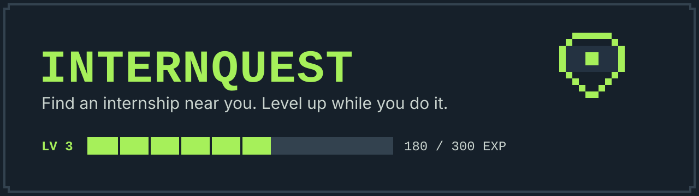

<div align="center">



<br>


**A game-like internship and OJT finder for the Philippines.**
Type your skills and city, see real matches near you, and turn the job hunt into a quest you can actually stick with.

</div>

---

## Why this exists

Looking for an internship is stressful, scattered, and lonely. Listings live on a dozen sites, nobody tells you *why* you're a fit (or what's missing), and one rejection can kill your momentum.

InternQuest puts it in one place:

- **See real listings first.** No sign-up wall. Pick a field, a few skills, and a city, and the list re-ranks as you go.
- **Know why a listing matches.** Every listing has a Match Panel: your match %, the skills you have, the skills you're missing, and a free resource for each gap.
- **Keep going.** An optional game layer (EXP, levels, weekly streaks, badges) rewards *effort*, not outcomes. A rejection reads "Quest failed, but you leveled up." It never shames you.
- **Opt out of the game, completely.** Full Quest, Light, or Plain. Plain mode is a clean tracker with no game elements, and it's designed, not a leftover.

## Features

| | |
|---|---|
| **Character sheet** | Username, city, skills as "abilities", interests, work-type preference. School is optional, so students, fresh grads, and career shifters are all welcome. |
| **Smart matching** | Rule-based score: 50% skills, 25% distance, 15% field, 10% work type. A full breakdown shows how the score was reached. Weights live in one config file. |
| **Match Panel** | Matched skills, missing skills, and 1 to 2 free learning resources per gap. Works for logged-out visitors too. |
| **Quest log** | Application tracker: Saved, Applied, Interview, Result. Drag and drop on desktop, tap-to-move on phones, with Undo on every change. |
| **"Did you apply?"** | Click Apply, come back to the tab, confirm in one tap. Server-side checks keep EXP honest. |
| **Tips and guides** | Resume, interview, and application guides in friendly plain language, linked to the exact step you're on. Printable checklists. |
| **Game layer** | EXP, level-ups, weekly streaks (with a monthly rest week), badges, weekly quests, and a leaderboard that unlocks at Level 3 and always shows your personal best. |
| **Privacy first** | Username and password only. No email or real name needed. Download or delete all your data any time. |
| **Companies** | Verified companies can post and close internships. No game elements on company or admin screens. |

## The look

Pixel-game style as a **layer** on a clean, readable base, like a pocket console. A dark bezel frames the app (header, nav, HUD) and the lime accent lives only there. Listings, forms, and tips stay calm and high-contrast on a light canvas.

| Token | Hex | Used for |
|---|---|---|
| `bezel` | `#16202a` | Console frame: header, nav, game panels |
| `lime` | `#a6f05a` | The one accent. Bezel only, never on light surfaces |
| `green` | `#0b6e42` | Actions, links, matched skills |
| `canvas` | `#eef2f0` | Page background |
| `ink` | `#121a21` | Body text |
| `alert` | `#c2412d` | Deadlines and errors |

Contrast is enforced by a test that reads the tokens and checks every text/background pair. The full reasoning is in [docs/DESIGN_DECISIONS.md](docs/DESIGN_DECISIONS.md).

## Tech stack

- **Next.js** (App Router) + **TypeScript** (strict) + **Tailwind CSS v4**
- **Supabase**: Postgres, row-level security, scheduled jobs
- **Vercel** for hosting, installable as a **PWA**
- **Vitest** for the matching, EXP, streak, and leaderboard logic, which lives as pure functions in `src/lib/`

## Getting started

```bash
git clone https://github.com/<your-username>/internquest.git
cd internquest
npm install
cp .env.example .env.local   # fill in values when a phase needs them
npm run dev                  # http://localhost:3000  (design system at /styleguide)
```

Before opening a pull request:

```bash
npm run check   # lint + type-check + tests
```

Never commit real keys. `.env.local` is git-ignored and `.env.example` documents every variable.

## Project layout

```
src/app/                 routes; globals.css holds every design token
src/components/ui/       plain UI components, used everywhere
src/components/game/     game layer (intern screens only)
src/components/providers GameModeProvider (Full / Light / Plain, reduced motion)
src/lib/                 pure logic: matching, EXP, streaks
tests/                   Vitest
content/tips/            Tips guides as markdown
supabase/migrations/     numbered SQL migrations
docs/                    user flows, wireframes, design system, decision log
```

## Roadmap

Built one phase at a time. Full details are in [SPEC.md](SPEC.md).

- [x] **Phase 0**: setup, folder structure, env variables, design tokens
- [x] **Design**: user flows, visual direction, design system, wireframes, screens ([docs/](docs/))
- [x] **Phase 1**: auth, profile, skills, location, seeded listings, search
- [x] **Phase 2**: matching engine wired to the database, Match Panel, `/go/:id`, quest log
- [x] **Phase 3**: EXP, levels, streaks, badges, modes, onboarding, leaderboard
- [x] **Phase 4**: tips content, skill-gap resources, optional AI helper
- [x] **Phase 5**: listings API adapter, dedupe, daily refresh jobs
- [x] **Phase 6**: company posting, verification, admin queue, reports
- [x] **Phase 7**: polish, accessibility, PWA, performance, pilot checklist

## Principles

- **Server is the referee.** EXP, streaks, and the leaderboard are calculated on the server only. The client is never trusted for rewards.
- **Accessible by default.** Keyboard support, screen reader labels, never color-only meaning, and `prefers-reduced-motion` respected.
- **Light on weak phones.** Mobile-first, skeleton loaders, no heavy UI libraries.
- **Respect the listing sources.** Only a short snippet from outside APIs, always with a link back.
- **Your data is yours.** Delete your account and everything goes with it.

## Documentation

| Doc | What's in it |
|---|---|
| [SPEC.md](SPEC.md) | Product and build spec |
| [DESIGN_BRIEF.md](DESIGN_BRIEF.md) | Design goals and process |
| [docs/USER_FLOWS.md](docs/USER_FLOWS.md) | Main user journeys |
| [docs/DESIGN_SYSTEM.md](docs/DESIGN_SYSTEM.md) | Tokens and components |
| [docs/WIREFRAMES.md](docs/WIREFRAMES.md) | Mobile and desktop layouts |
| [docs/DESIGN_DECISIONS.md](docs/DESIGN_DECISIONS.md) | Why every big choice was made |
| [docs/SUPABASE_SETUP.md](docs/SUPABASE_SETUP.md) | Connecting the database, admins, and the daily job |
| [docs/PILOT_CHECKLIST.md](docs/PILOT_CHECKLIST.md) | Everything to set up, decide, and test before the pilot |

## Contributing

This started as a school project and is heading toward a real launch. Ideas and bug reports are welcome. See [CONTRIBUTING.md](CONTRIBUTING.md). To report a security problem, see [SECURITY.md](SECURITY.md).

## License

[MIT](LICENSE) © 2026 nixxinix

InternQuest is a working name and may change before launch.
